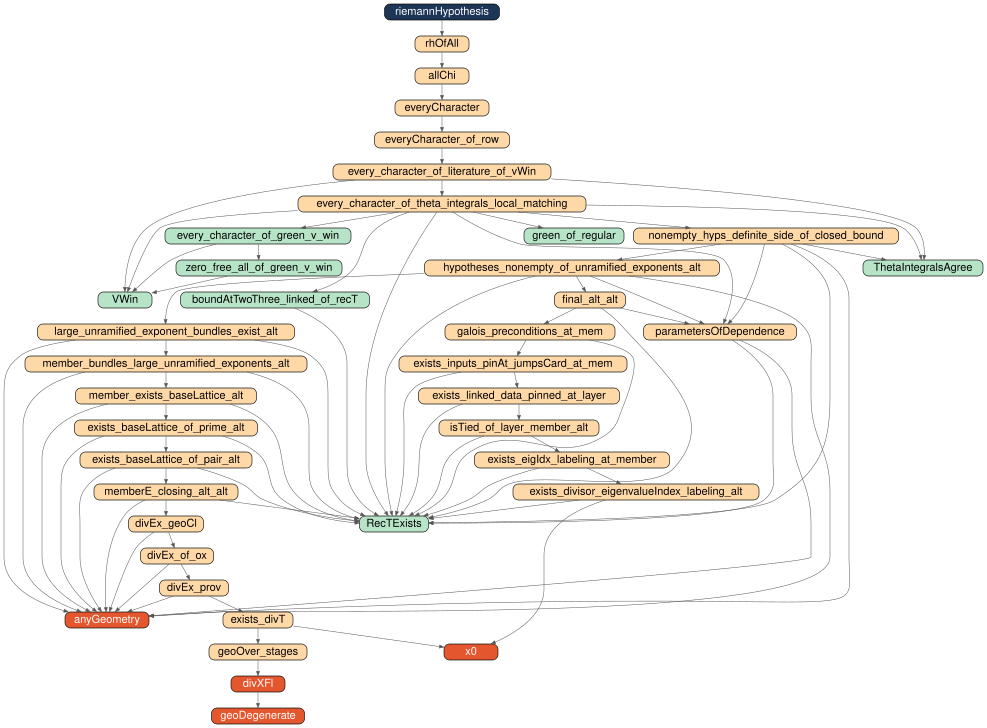

```{r setup}
read_tsv <- function(file, ...) {
  utils::read.delim(file.path("results", file), quote = "", stringsAsFactors = FALSE, ...)
}
stats <- read_tsv("stats.txt", header = FALSE, col.names = c("key", "value"))
stat <- function(key) format(stats$value[stats$key == key], big.mark = ",")
dependents <- read_tsv("witness_dependents.tsv")
key_decls <- read_tsv("key_declarations.tsv")
premises <- read_tsv("join_lemma_premises.tsv")
consumers <- read_tsv("certificate_consumers.tsv")
absent <- read_tsv("absent_constants.tsv")
cut_test <- read_tsv("cut_test.tsv")
short <- function(x) sub("^.*\\.", "", x)
short2 <- function(x) sub("^.*\\.([^.]+\\.[^.]+)$", "\\1", x)
```

This is an agent exploration. The investigation, the tools and this text were made in the
[Pi coding agent](https://github.com/earendil-works/pi) with Claude Fable 5.2 and Claude Opus 5.5,
directed by [sounkou-bioinfo](https://github.com/sounkou-bioinfo). The proof under study is
reported to be generated with a Claude model, presumably Claude Fable 5.5, so the analysing
models and the generating model come from the same family. Read the
conclusions with that conflict in mind and check them against the data in `results/` and
the tools in `tool/`.

## The question

On 20 November 2026 Levent Alpöge released a proof of the Riemann Hypothesis as a Lean
library. J. L. Nielsen's paper *The Invalidity of Alpöge's Proposed Proof of the Riemann
Hypothesis* (PhilArchive NIEIOT-2) reports that the hypothesis bundle in the proof rests on
witnesses that are vacuously true. In the source, the geometry predicate is

``` lean
def anyGeometry : GeoP := fun _ _ _ => True
```

Her §10 says that she did not run a compiled dependency trace. nomad421's note "What follows
from the dependency trace in the Riemann Hypothesis proof?" asks for the step where the formal
proof needs a geometric fact and accepts the trivial certificate in its place.

This repository runs the trace on the compiled proof, the kernel export that the independent
checkers accepted.

**In short:** the vacuous witnesses are in the compiled proof, as Nielsen says. Nothing reads
them, as nomad421 says. They reach the main theorem through one lemma, by the premises that
assemble the hypothesis bundle. The step that derives nonvanishing does not depend on them.
The step from host data to the Riemann Hypothesis is short and explicit. The hard content is
in the supply of one existence statement, `TopG`: the bundle `HypsAlt` (60% of the proof
term), the window statement `VWin` and the shape lemma. The vacuous witnesses are filler
inside the bundle supply.

## Why a vacuous witness can be harmless

Take a lemma that is uniform in the geometry parameter $\Gamma$ and whose conclusion $C$ does
not mention $\Gamma$:

$$
L : \forall \Gamma : \mathrm{GeoP}, \quad H(\Gamma) \to \mathrm{GeoCl}(\Gamma) \to C
$$

Instantiate it at the constant predicate $\Gamma^{\top} := \lambda D J X. \top$, which is
`anyGeometry`. The certificate $\mathrm{GeoCl}(\Gamma^{\top})$ is then free, and $L$ proves $C$
from $H(\Gamma^{\top})$ alone. The certificate carries
information to $C$ only if some step *eliminates* it: a recursor on $\mathrm{GeoCl}$, a
projection of its field, or a lemma such as `geoOf_surf` that extracts a surface from it. If
no step does, the vacuous witness is dead weight. It makes the names misleading. It does not
make $C$ easier to reach than $H$ alone.

So the question becomes a graph question: is there a path from `riemannHypothesis` to the
witnesses, and does any declaration on such a path eliminate them?

## The dependency graph

```{r depgraph, fig.cap = "Every dependency path from riemannHypothesis to the four vacuous witnesses that Nielsen names (red). Orange: depends on a vacuous witness. Green: does not. An arrow points from a declaration to a constant that its compiled term uses directly."}
nodes <- read_tsv("fig_nodes.tsv", header = FALSE,
                  col.names = c("id", "short", "name", "kind", "vacuous", "witness"))
edges <- read_tsv("fig_edges.tsv", header = FALSE, col.names = c("src", "dst"))
fill <- ifelse(nodes$witness, "#e4572e", ifelse(nodes$vacuous, "#ffd8a8", "#b7e4c7"))
font <- ifelse(nodes$witness, "white", "black")
root <- nodes$short == "riemannHypothesis"
fill[root] <- "#1d3557"
font[root] <- "white"
dot <- c(
  "digraph G {",
  "  rankdir=TB; nodesep=0.12; ranksep=0.22; bgcolor=\"white\";",
  "  node [shape=box, style=\"rounded,filled\", fontname=\"Helvetica\", fontsize=11, height=0.22, margin=\"0.06,0.02\", penwidth=0.6];",
  "  edge [arrowsize=0.45, penwidth=0.5, color=\"#555555\"];",
  sprintf("  n%s [label=\"%s\", fillcolor=\"%s\", fontcolor=\"%s\"];", nodes$id, nodes$short, fill, font),
  sprintf("  n%s -> n%s;", edges$src, edges$dst),
  "}"
)
dir.create("figures", showWarnings = FALSE)
writeLines(dot, "figures/depgraph.dot")
status <- system2("dot", c("-Tsvg", "figures/depgraph.dot", "-o", "figures/depgraph.svg"))
stopifnot(status == 0)

```

```{r witness-table}
w <- dependents[dependents$depth == 0, c("witness", "name")]
w$namespace <- sub("\\.[^.]+$", "", w$name)
w$dependents <- vapply(w$witness, function(x) sum(dependents$witness == x), integer(1))
rh <- dependents[short(dependents$name) == "riemannHypothesis", c("witness", "depth")]
w$distance <- rh$depth[match(w$witness, rh$witness)]
w <- w[order(w$distance), ]
knitr::kable(
  data.frame(Witness = paste0("`", w$witness, "`"), Namespace = paste0("`", w$namespace, "`"),
             Dependents = w$dependents, `Steps from riemannHypothesis` = w$distance,
             check.names = FALSE),
  row.names = FALSE
)
```

The export holds `r stat("decl_blocks")` declarations. The walk from the five theorems in
`Main.lean` reaches `r stat("closure_blocks")` of them. Of those, only
**`r length(unique(dependents$name))`** depend on any of the four witnesses.

- **Every path to the witnesses goes through one lemma**,
  `every_character_of_theta_integrals_local_matching`. If that lemma is removed from the
  graph, `r cut_test$witnesses_still_reachable` witnesses remain reachable from
  `riemannHypothesis`.
- **The paths enter that lemma through the premises that assemble the hypothesis bundle**:
  `r paste0("\x60", short(premises$name[premises$depends_on_vacuous_witness == "true"]), "\x60", collapse = " and ")`.
- **The other premises of the lemma do not depend on the witnesses.** Neither does the step
  that derives nonvanishing from the bundle:

```{r key-table}
k <- key_decls
knitr::kable(
  data.frame(Declaration = paste0("`", short(k$name), "`"),
             `Depends on a vacuous witness` = ifelse(k$depends_on_vacuous_witness == "true", "yes", "no"),
             check.names = FALSE),
  row.names = FALSE
)
```

## Is the content of a certificate ever read?

```{r consumer-table}
cons <- aggregate(used_by ~ constant, data = transform(consumers, used_by = ifelse(is.na(used_by) | used_by == "", "none", short(used_by))),
                  FUN = function(x) paste(x, collapse = ", "))
abs_tbl <- data.frame(constant = absent$constant,
                      used_by = ifelse(absent$present_in_export == 0, "not in the export", "present"))
knitr::kable(
  data.frame(`Constant` = paste0("`", c(short2(cons$constant), abs_tbl$constant), "`"),
             `Used by` = c(cons$used_by, abs_tbl$used_by), check.names = FALSE),
  row.names = FALSE
)
```

`GeoCl.rec` is used only by the `GeoCl` block itself. `OAt.rec` has no users. The two users of
`OAt.geo` pass the field to `GeoCl.step` and `geoCl_of`, which build another certificate.
The lemmas that would extract a surface from the real geometry predicate are not in the
export.

## Nielsen's four checks

Nielsen's §9 lists four checks that would confirm or refute her analysis.

1. **Independent kernel replay.** Andrew Sutherland reports that nanoda accepts the export,
   con-leche accepts all 1,468,418 declarations and justifies the five statements against a
   Mathlib-only challenge, and lean4lean accepts all 175,187 modules. The Lean 4.36.0
   Comparator run has passed the statement comparison and the axiom check. Its kernel stages
   were still running when this was written. nanoda and con-leche check the exported term
   without code compiled by Lean 4.33.1.
2. **Dependency walk.** All four witnesses are in the closure. *This confirms her finding in
   the compiled term.*
3. **The degree equation.** `FrobeniusOrbitPlaceCount` is not in the export. *The concern
   does not arise.*
4. **The remaining hypotheses.** See the next section. *The content is located and measured.
   It is in the derivation of one existence statement, `TopG`. Its mathematical meaning is not
   explained here.*

## Check 4: where the content is

The compiled proof reaches the Riemann Hypothesis through a weighted Chebyshev function.
With the von Mangoldt function $\Lambda$ and Euler's constant $\gamma$, the source defines

$$
S(x) = \sum_{n \le x} \Lambda(n)\left(\frac{x}{n} - 1\right), \qquad
G_z(x) = S(x) - x \log x + (1 + \gamma) x
$$

and, for a level $\Lambda$ with characters $\psi$ and weights $w_\psi$,

$$
G_m(x) = G_z(x) + \sum_{\psi} w_\psi \mathrm{Re} \left( g_{\chi_\psi}(x) \right)
$$

where $g_\chi$ is the same construction twisted by $\chi$. A bound $G_m(x) \le x^{1/2+\varepsilon}$ for all small
$\varepsilon$ is as strong as the Riemann Hypothesis for these characters. The proof makes
three moves:

$$
\mathrm{TopG}
\quad \xrightarrow{\text{hosts at every scale}} \quad
\exists H. \quad \mathrm{EAtH}(H, x) \wedge \mathrm{CoreAtH}(H, x)
$$

$$
\xrightarrow{\text{core-gm}} \quad
G_m(x) \le x^{\frac{1}{2} + (e_D + e_L + 7)\varepsilon}
\quad \xrightarrow{\text{formB}} \quad
L(s, \chi) \ne 0 \quad \text{for } \mathrm{Re}(s) > \frac{1}{2}
$$

- `formB` turns a growth bound for $G_m$ on windows into a zero-free half-plane.
- `core_gm` ("core-gm" above) derives the bound on $G_m(x)$ from a *host* $H$ at scale $x$:
  the analytic conditions `EAtH` and the conditions `CoreAtH`. Its source is 74 lines, but
  these lines only unpack `CoreAtH` (about 40 components, one of them a window bundle of 28
  fields) and pass them to `Deduction.ch_core` and `Deduction.ch_top`, which do the
  estimate.
- `TopG` states that for every small $\varepsilon$ there is a family of hosts satisfying
  these conditions at every large window scale. `zero_free_all_of_green_v_win` derives it
  from `Green`, `VWin` and the bundle `HypsAlt`, through `shape_closed_link_n_of_green`.

The size of each premise's dependency cone, counting only the project's own declarations,
shows where the work is. The cones overlap, so the shares do not add up to 100%.
"Exclusive" counts declarations that are in exactly one of the premise cones.

```{r cone-table}
cm <- read_tsv("cone_mass.tsv")
total <- cm$project_nodes[cm$cone == "*riemannHypothesis"]
label <- c(
  "*riemannHypothesis" = "whole proof",
  "nonempty_hyps_definite_side_of_closed_bound" = "supply of the bundle HypsAlt",
  "vwin_of_row" = "window supply (VWin)",
  "topCovolSlim2_use_alt_alt" = "covolume bound",
  "shape_closed_link_n_of_green" = "Green => TopG shape",
  "tLiftK" = "theta lift (Row0b)",
  "recTExists" = "local Langlands parameters",
  "*zeroFreeAll_of_topG" = "TopG => zero-free (whole endgame)",
  "level_gm_le_on_family_scales" = "hosts => bound on G_m (core_gm)",
  "green_of_regular" = "Green",
  "formB" = "bound on G_m => zero-free")
knitr::kable(
  data.frame(Cone = paste0("`", sub("^\\*", "", cm$cone), "`"), Role = label[cm$cone],
             `Declarations` = format(cm$project_decls, big.mark = ","),
             `Share of proof term` = sprintf("%.2f%%", 100 * cm$project_nodes / total),
             `Exclusive declarations` = ifelse(grepl("^\\*", cm$cone), "", format(cm$exclusive_decls, big.mark = ",")),
             check.names = FALSE),
  row.names = FALSE
)
```

```{r true-defs}
td <- read_tsv("true_defs.tsv")
endgame <- sum(td$in_zeroFreeAll_of_topG == "true")
in_hyps <- sum(td$in_hyps_bundle == "true")
```

The step from `TopG` to nonvanishing is small: `r format(cm$project_decls[cm$cone == "*zeroFreeAll_of_topG"], big.mark = ",")`
declarations, `r sprintf("%.2f%%", 100 * cm$project_nodes[cm$cone == "*zeroFreeAll_of_topG"] / total)` of the
proof term. Small does not mean easy to read: it holds `ch_core` and `ch_top`, which have
not been read for this report. A census of the whole project finds
`r nrow(td)` definitions whose body is the constant `True`. `r endgame` of them are in this
endgame and `r in_hyps` are in the supply of `HypsAlt`. Their names show that they fill slots:
`r paste0("\x60", unique(short(td$name[grepl("Unused|NoCondition|noCondition|trivial", td$name)])), "\x60", collapse = ", ")`.

So the answer to check 4 is the following. The content is the supply of `TopG`: hosts with
the conditions `EAtH` and `CoreAtH` at every large scale, for every small $\varepsilon$. That
statement is as strong as the Riemann Hypothesis, and its supply is most of the proof. The
supply of the bundle `HypsAlt` is where Nielsen's vacuous witnesses are, together with most
of the `True` slots. A field of type `True` carries no information, and for the geometry
fields the tests above show that nothing reads them. Which of the other fields supply the
conditions that `core_gm` uses is not traced here. The analytic deduction from `TopG` to
nonvanishing does not depend on any `True` slot.

A dependency graph cannot decide whether the supply of `TopG` is a mathematical argument
that a person can follow, or whether a non-vacuous condition in it is false and still
accepted. A false condition cannot be proved in a sound kernel.

The endgame was then read in the source, step by step: [`docs/semantic-trace.md`](docs/semantic-trace.md).
`formB`, `core_gm`, `ch_core` and `ch_top` are valid reductions with no vacuous condition.
Each one moves the hard estimate into a hypothesis. After `ch_top`, the estimate with the
strength of the Riemann Hypothesis is a set of inequalities on an abstract record that
`IdentU` identifies with a real prime sum. Where those inequalities are proved has not been
read yet.

## Assessment

**Nielsen is right that** the geometry predicate is `True`, that the vacuous witnesses are
in the dependency closure, that the lemmas written to extract geometric content are never
used, and that the geometric story in the source is not the argument that derives the
theorem. A reader who follows the names in the source is misled.

**nomad421 is right that** no step uses the trivial certificate as evidence for a geometric
object. The graph confirms this for every reachable declaration.

**On validity.** A vacuous definition can make a step easier. It cannot make a false
statement derivable in a sound kernel. The derivation that was checked does not get its
conclusion from the witnesses. If the proof is wrong, the fault is in kernel soundness, in
the meaning of the statement (Mathlib's `riemannZeta` and `RiemannHypothesis` at the pinned
version, and the challenge comparison), or in the identity of the checked artifact. Nielsen's
argument addresses none of these. The derivation of `TopG` holds the content, and nobody
has yet explained it as mathematics.

## Limits

- No kernel was run for this work. Acceptance of the export comes from Sutherland's runs.
- The graph records which constants a term contains, not how the term uses them. "Never read"
  rests on the absence of eliminations and projections.
- The census of vacuous definitions finds only definitions whose body is the constant
  `True`. Other forms of vacuity, such as degenerate data or conditions that hold for
  trivial reasons, are not detected.
- The size of a proof term measures work done by the machine, not mathematical depth.
  Generated proofs can be large for reasons unrelated to difficulty.
- A reference to any name in an inductive block brings in the whole block, so the graph
  over-approximates the dependencies.

## Method

```{r stats-table}
s <- stats[!grepl("^blocks_", stats$key), ]
labels <- c(lines = "NDJSON lines", exprs = "Expression nodes", decl_blocks = "Declaration records",
            closure_blocks = "Reachable from the five main theorems", edges = "Direct dependency edges",
            proj_uses = "Structure projections (Expr.proj)")
knitr::kable(data.frame(Quantity = labels[s$key], Value = format(s$value, big.mark = ",")),
             row.names = FALSE)
```

`tool/rhgraph.c` streams Sutherland's export
(`https://math.mit.edu/~drew/grh/solution.ndjson.zst`, SHA-256
`61a8938ad5f5e57397c1c0e3b954916af546d9004ade01c3555744a681b05381`, built from
`leanprover-community/riemann-hypothesis` at `40e56bab`) and keeps the expression DAG in
memory. It walks the type, value and recursor rules of every declaration reachable from the
roots, and writes one edge per constant that a declaration uses directly. The edges are
queried in DuckDB: `tool/anc.sh` computes the dependents of a declaration by breadth-first
search on the reversed edges.

### Reproduction

Requirements: a C compiler, `zstd`, DuckDB 1.x, about 60 GB of RAM and about 10 minutes for
the graph build. Rendering this file needs Quarto, R with knitr, and Graphviz.

``` sh
curl -LO https://math.mit.edu/~drew/grh/solution.ndjson.zst
gcc -O2 -o rhgraph tool/rhgraph.c
mkdir out
zstd -dc --long=31 solution.ndjson.zst | ./rhgraph out riemannHypothesis \
  riemannZeta_eq_zero_re LFunction_ne_zero_of_half_lt_re \
  LFunction_eq_zero_re LFunction_eq_zero_re_of_isPrimitive
cp out/stats.txt results/
cd out
duckdb graph.duckdb < ../sql/load.sql
../tool/anc.sh graph.duckdb anc_any    GlobalTheory.Mem.Top.Bl.anyGeometry
../tool/anc.sh graph.duckdb anc_geodeg Formalism.L2.Geo.geoDegenerate
../tool/anc.sh graph.duckdb anc_divxfl Formalism.L2.Geo.divXFl
../tool/anc.sh graph.duckdb anc_x0     GlobalTheory.Mem.Top.DivRec.x0
duckdb graph.duckdb < ../sql/queries.sql
sed "s#RESULTS#$PWD/../results#g" ../sql/export_results.sql | duckdb graph.duckdb
# forward cones for check 4: run tool/desc.sh for each cone listed in sql/content.sql
sed "s#RESULTS#$PWD/../results#g" ../sql/content.sql | duckdb graph.duckdb
cd .. && quarto render README.qmd
```

| Path | Content |
|---|---|
| `README.qmd` | This document. It renders `README.md` and `rh-claude-alpoge-graphs.pdf` |
| `tool/rhgraph.c` | Export reader and graph builder |
| `tool/anc.sh` | Dependents of one declaration, in DuckDB |
| `tool/desc.sh` | Forward dependency cone of one declaration, in DuckDB |
| `sql/` | Load script, the queries behind each result, and the export of `results/` |
| `results/` | The result tables that this document reads |
| `figures/` | The graph, generated when this document is rendered |
| `docs/` | Longer documents linked from this README: `semantic-trace.qmd` reads the endgame in the source |

Nielsen's paper is not redistributed. The export and the full graph tables (about 5 GB) are
not included. They can be rebuilt with the commands above.
